<!--
  ╔══════════════════════════════════════════════════════════════════╗
  ║  Debanjan Roy · Senior Full Stack & AI Engineer · Kolkata, India  ║
  ║  github.com/Debanjan-Projects                                     ║
  ╚══════════════════════════════════════════════════════════════════╝
-->

  

 

 

<table>
<tr>
<td width="60%" valign="top">

I'm **Debanjan Roy** (Babai), a **Senior Software Engineer & AI Engineer** from **Kolkata, India**, with **1+ year of professional experience** building production-grade web, mobile and AI products.

At **Bengal IT Hub** I lead a remote engineering team, from planning and architecture through code review and client delivery. At **Sibiri Innovation** I design **agentic AI systems**: multi-agent workflows with **LangGraph**, **RAG** pipelines, and **offline LLM** applications that run fully on-device.

My path started with web development (MERN, PHP/Laravel, Java), moved into mobile (React Native, Flutter), and now centres on **Generative & Agentic AI**. I enjoy taking a raw idea, shaping the architecture, and shipping a product people actually use.

> 💡 *"Build it right, ship it fast, then make it better."*

</td>
<td width="40%" valign="top" align="center">

</td>
</tr>
</table>

| 📍 Location | 💼 Experience | 🎯 Focus | 🤝 Open to |
|:--:|:--:|:--:|:--:|
| Kolkata, West Bengal, India | 1+ year · 2 current roles | Agentic AI · Full Stack · Mobile | AI products · Freelance · Collaboration |

 

 

<table align="center">
<tr>
<td align="center" width="170"><b>💻 Languages</b></td>
<td></td>
</tr>
<tr>
<td align="center"><b>🎨 Frontend</b></td>
<td></td>
</tr>
<tr>
<td align="center"><b>📱 Mobile</b></td>
<td> React Native · Flutter · Android Studio</td>
</tr>
<tr>
<td align="center"><b>⚙️ Backend</b></td>
<td></td>
</tr>
<tr>
<td align="center"><b>🗄️ Databases</b></td>
<td></td>
</tr>
<tr>
<td align="center"><b>🧠 AI / ML / Data</b></td>
<td>
 

</td>
</tr>
<tr>
<td align="center"><b>☁️ Cloud & DevOps</b></td>
<td></td>
</tr>
<tr>
<td align="center"><b>🧰 Tools</b></td>
<td></td>
</tr>
</table>

 

 

  
  

  
  

🍽️ Also see <a href="https://restoran-php-2gdh.vercel.app/"><b>Restoran</b></a>, a restaurant website built with PHP

 

 

 

<picture>
  <source media="(prefers-color-scheme: dark)"  srcset="https://raw.githubusercontent.com/Debanjan-Projects/Debanjan-Projects/output/github-snake-dark.svg"/>
  <source media="(prefers-color-scheme: light)" srcset="https://raw.githubusercontent.com/Debanjan-Projects/Debanjan-Projects/output/github-snake.svg"/>
  
</picture>

 

I'm always open to discussing **AI products**, **full-stack platforms**, **mobile apps** or new opportunities.

  

⭐ If you like my work, star a repo. It keeps me building.

