<!-- ════════════════════════════════════════════════════════════════════
     Debanjan Roy · github.com/Debanjan-Projects
     Banner + dot portrait live in /assets (generated from my profile photo)
     ════════════════════════════════════════════════════════════════════ -->

<div align="center">



<a href="https://git.io/typing-svg">
  
</a>

<br/>

<a href="https://www.linkedin.com/in/debanjan-roy7/"></a>
<a href="mailto:debanjanroy123456@gmail.com"></a>
<a href="https://leetcode.com/u/debaanjan_roy/"></a>
<a href="https://www.hackerrank.com/profile/debanjanroy12341"></a>


</div>

---

<table>
<tr>
<td width="58%" valign="top">

### 🧠 About me

```js
const debanjan = {
  name:      "Debanjan (Babai) Roy",
  basedIn:   "Kolkata, West Bengal, India",
  roles: [
    "Senior Software Engineer · Team Lead @ Bengal IT Hub",
    "AI Engineer @ Sibiri Innovation (OPC) Pvt Ltd",
  ],
  focus:     ["Agentic AI", "Generative AI", "Full Stack", "Mobile"],
  aiStack:   ["LangChain", "LangGraph", "RAG", "Ollama", "ML / DL"],
  webStack:  ["MERN", "Spring Boot", "Laravel", "FastAPI"],
  mobile:    ["React Native", "Flutter"],
  alsoInto:  ["Networking", "Security", "Data Science"],
  motto:     "Build it, ship it, then make it better.",
};
```

</td>
<td width="42%" valign="top" align="center">


</td>
</tr>
</table>

### ⚡ What I do

- 🤖 **Agentic AI systems** — multi-agent workflows with **LangGraph + LangChain**, RAG pipelines (ChromaDB, sentence-transformers), local LLMs with **Ollama**
- 🌐 **Full-stack products** — scalable web platforms with **MERN**, **Spring Boot**, **Laravel** and **FastAPI**
- 📱 **Cross-platform apps** — **React Native** and **Flutter** apps from design to store
- 📊 **ML · Deep Learning · Data Science** — from data wrangling with NumPy/Pandas to model training and evaluation
- 👥 **Team leadership** — leading a remote engineering team, planning sprints, reviewing code, shipping client work

---

## 🛠️ Tech Stack

<div align="center">

**Languages**<br/>


**Frontend · Mobile**<br/>


**Backend · Databases**<br/>


**AI · ML · Data**<br/>


**Cloud · DevOps · Tools**<br/>


</div>

---

## 💼 Experience

| When | Role | Where |
|:--|:--|:--|
| **Aug 2026 – Now** | 🤖 **AI Engineer** | Sibiri Innovation (OPC) Pvt Ltd · Kolkata |
| **Apr 2026 – Now** | 👨‍💻 **Senior Software Engineer · Team Lead** | Bengal IT Hub · Remote |
| Dec 2025 – Apr 2026 | Junior Software Engineer (Intern) | Biswa Bangla Hub · Kolkata |
| Apr 2025 – Nov 2025 | Agentic AI Intern | Sibiri Innovation · Kolkata |
| Aug 2024 – Sep 2024 | PHP & MySQL Trainee | Euphoria GenX · Kolkata |
| Jan 2024 – Mar 2024 | JavaScript Trainee | Nikhil Bharat Shiksha Parishad · Remote |
| Dec 2023 – Feb 2024 | Full Stack (MERN) Trainee | Euphoria GenX · Kolkata |

---

## 🚀 Featured Work

<table>
<tr>
<td width="50%" valign="top">

### 🎓 SIBIRI — Educational Content OS
An **agentic AI system for teachers**: upload notes → agents analyse the lesson, plan content, and generate quizzes, videos, labs and mind maps → publish to Moodle. The teacher reviews instead of creating from scratch.

`LangGraph` `LangChain` `RAG · ChromaDB` `FastAPI` `Celery` `PostgreSQL` `Moodle API`

</td>
<td width="50%" valign="top">

### 🛠️ EngiMate — Offline AI Agent
A **fully offline AI assistant for engineering students** on Windows / macOS / Linux, powered by local LLMs. v2 adds voice-to-text note-making and spoken-English practice. Licensed per machine via [sibiri.in](https://sibiri.in).

`Python` `Ollama` `Local LLMs` `Speech-to-Text` `Nuitka`

</td>
</tr>
<tr>
<td width="50%" valign="top">

### 🔐 FastGate — AI Gate-Pass Platform
Full UI/UX website for an **AI-enabled gate-pass & campus-security product**: multi-page, dark/light themes, 3D visuals and animation.
🔗 [fastgate.in](https://fastgate.in)

`UI/UX` `Responsive` `Animations` `Theming`

</td>
<td width="50%" valign="top">

### ✈️ Dhanantari Tourism Suite
Travel and education platforms for **Dhanantari Tourism Pvt Ltd** (Swapnokamal, Anukul & Rajeet Travels) and **Kamal Dutta Education**, growing into an ERP / SaaS product.

`Laravel` `PHP` `MySQL` `ERP`

</td>
</tr>
</table>

<div align="center">

🍽️ Also: [**Restoran Website**](https://restoran-php-2gdh.vercel.app/) — a PHP restaurant site

</div>

---

## 📊 GitHub Analytics

<div align="center">


</div>

---

## 🐍 Contribution Snake

<div align="center">
<picture>
  <source media="(prefers-color-scheme: dark)"  srcset="https://raw.githubusercontent.com/Debanjan-Projects/Debanjan-Projects/output/github-snake-dark.svg" />
  <source media="(prefers-color-scheme: light)" srcset="https://raw.githubusercontent.com/Debanjan-Projects/Debanjan-Projects/output/github-snake.svg" />
  
</picture>
</div>

---

<div align="center">

### 🤝 Let's build something

Open to **AI products, full-stack platforms, mobile apps** and collaboration.<br/>
📫 **debanjanroy123456@gmail.com** · 💼 [LinkedIn](https://www.linkedin.com/in/debanjan-roy7/)


</div>
