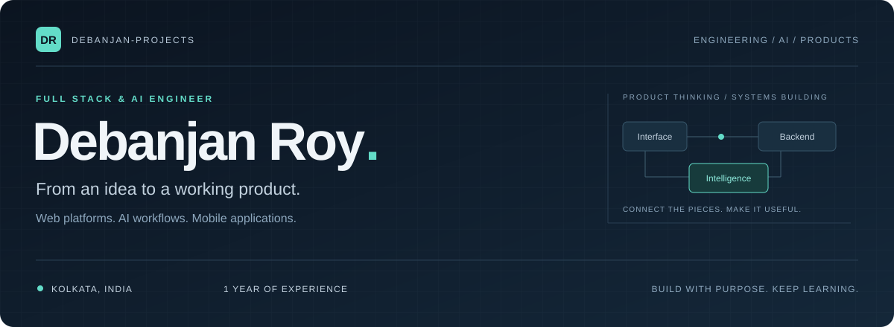

 

**Web platforms. AI workflows. Applications people can use.**

[About](#01--about) &nbsp; / &nbsp; [Selected work](#02--selected-work) &nbsp; / &nbsp; [Toolkit](#03--technology-toolkit) &nbsp; / &nbsp; [Experience](#04--experience) &nbsp; / &nbsp; [Connect](#05--lets-connect)

## 01 / About

I'm **Debanjan (Babai) Roy**, a **Full Stack & AI Engineer** based in **Kolkata, India**, with **1 year of experience**. I build across the product: interfaces, backend services, databases, and the AI workflows that connect them.

My work includes educational AI systems, offline assistants, campus-security interfaces, and business applications. I'm particularly interested in making AI useful in everyday workflows, whether that means helping a teacher prepare a lesson or bringing an assistant onto a student's own computer.

I work with **LangChain, LangGraph, RAG, and local LLMs**, alongside web and mobile technologies. My experience also includes coordinating development, reviewing code, and contributing to team delivery.

> **Understand the problem. Build with purpose. Improve through iteration.**

| Building | Exploring | Working with others |
| :--- | :--- | :--- |
| Full-stack products, agent workflows, and cross-platform apps | Machine learning, deep learning, data science, networking, and security | Sprint planning, code review, and product delivery |

## 02 / Selected work

<table>
<tr>
<td width="50%" valign="top">

01 &nbsp; / &nbsp; AI FOR EDUCATION

### SIBIRI
**Educational Content OS**

An agentic AI system that turns teaching notes into lesson materials. Workflows analyse content and generate quizzes, videos, labs, and mind maps, with teacher review before publication to Moodle.

**Stack** 
LangGraph · LangChain · FastAPI · ChromaDB · Celery · PostgreSQL · Moodle API

</td>
<td width="50%" valign="top">

02 &nbsp; / &nbsp; LOCAL AI

### EngiMate
**Offline assistant for engineering students**

An AI assistant powered by local language models for Windows, macOS, and Linux. Its scope includes voice-to-text notes and spoken-English practice, with per-machine licensing.

**Stack** 
Python · Ollama · Local LLMs · Speech-to-text · Nuitka

[Explore Sibiri ↗](https://sibiri.in)

</td>
</tr>
<tr>
<td width="50%" valign="top">

03 &nbsp; / &nbsp; WEB EXPERIENCE

### FastGate
**Campus-security product website**

A multi-page website and UI/UX for an AI-enabled gate-pass platform. The experience includes responsive layouts, light and dark themes, animation, and 3D visuals.

**Focus** 
UI/UX · Responsive design · Theming · Animation

[Visit FastGate ↗](https://fastgate.in)

</td>
<td width="50%" valign="top">

04 &nbsp; / &nbsp; BUSINESS APPLICATIONS

### Tourism & Education
**Platforms for real business workflows**

Work for Dhanantari Tourism Pvt Ltd, including Swapnokamal, Anukul, and Rajeet Travels, and Kamal Dutta Education, extending toward ERP and SaaS workflows.

**Stack** 
Laravel · PHP · MySQL

</td>
</tr>
</table>

**Also built:** [Restoran — PHP restaurant website](https://restoran-php-2gdh.vercel.app/) &nbsp; · &nbsp; [Browse public repositories →](https://github.com/Debanjan-Projects?tab=repositories)

## 03 / Technology toolkit

My toolkit spans professional work, projects, and continued learning. **Full-stack development and AI applications are my main focus.**

**Languages**

Python · Java · JavaScript · PHP · C · Dart · HTML · CSS

**Frontend & mobile**

React · React Native · Flutter · Tailwind CSS · Bootstrap · Figma

**Backend & databases**

Node.js · Express · Spring Boot · Laravel · FastAPI · MongoDB · MySQL · PostgreSQL · Firebase

**AI & language models**

Agent workflows · Retrieval-augmented generation · Local inference · Document processing

**Machine learning & data**

**Cloud & development tools**

AWS · Google Cloud · Linux · Git · GitHub · Vercel · VS Code · Postman

## 04 / Experience

**1 year of experience**, with internships and technical training also listed below. Concurrent roles are shown separately.

| Period | Role | Organization |
| :--- | :--- | :--- |
| Aug 2026 – Present | **AI Engineer** | Sibiri Innovation (OPC) Pvt Ltd · Kolkata |
| Apr 2026 – Present | **Senior Software Engineer · Team Lead** | Bengal IT Hub · Remote |
| Dec 2025 – Apr 2026 | Junior Software Engineer Intern | Biswa Bangla Hub · Kolkata |
| Apr 2025 – Nov 2025 | Agentic AI Intern | Sibiri Innovation · Kolkata |

<strong>Earlier technical training</strong>

| Period | Training | Organization |
| :--- | :--- | :--- |
| Aug 2024 – Sep 2024 | PHP & MySQL | Euphoria GenX · Kolkata |
| Jan 2024 – Mar 2024 | JavaScript | Nikhil Bharat Shiksha Parishad · Remote |
| Dec 2023 – Feb 2024 | Full Stack (MERN) | Euphoria GenX · Kolkata |

### Beyond project work

I practise programming and problem-solving alongside product development, and continue learning across AI engineering and software fundamentals.

<strong>GitHub contribution activity</strong>

<picture>
  <source media="(prefers-color-scheme: dark)" srcset="https://raw.githubusercontent.com/Debanjan-Projects/Debanjan-Projects/output/github-snake-dark.svg" />
  <source media="(prefers-color-scheme: light)" srcset="https://raw.githubusercontent.com/Debanjan-Projects/Debanjan-Projects/output/github-snake.svg" />
  
</picture>

<!-- Generated by .github/workflows/snake.yml after its first successful run. -->

## 05 / Let's connect

Interested in **AI products, full-stack platforms, or mobile applications**? I'd be happy to discuss a project or collaboration.

**[debanjanroy123456@gmail.com](mailto:debanjanroy123456@gmail.com)** &nbsp; · &nbsp; [LinkedIn](https://www.linkedin.com/in/debanjan-roy7/) &nbsp; · &nbsp; [GitHub](https://github.com/Debanjan-Projects)

---

<strong>DEBANJAN ROY</strong> &nbsp; / &nbsp; Kolkata, India Build with purpose. Keep learning.

